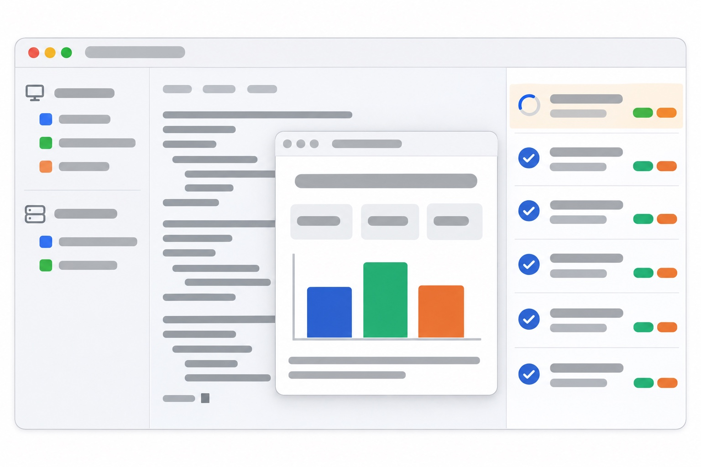
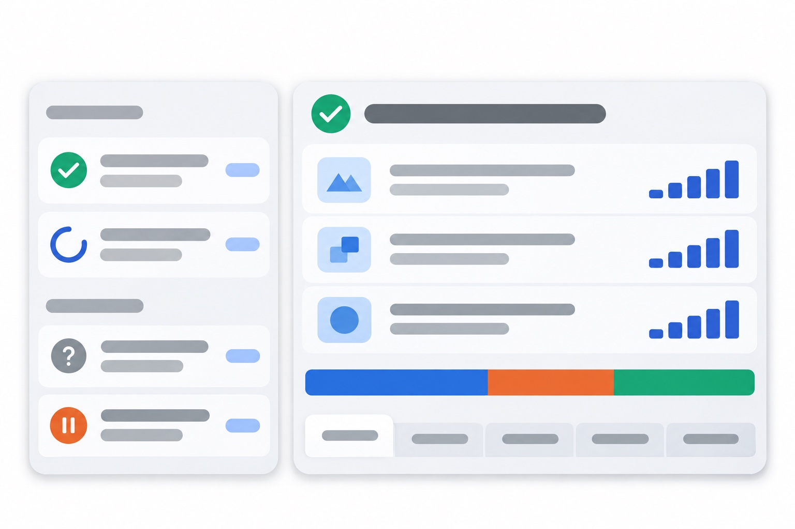
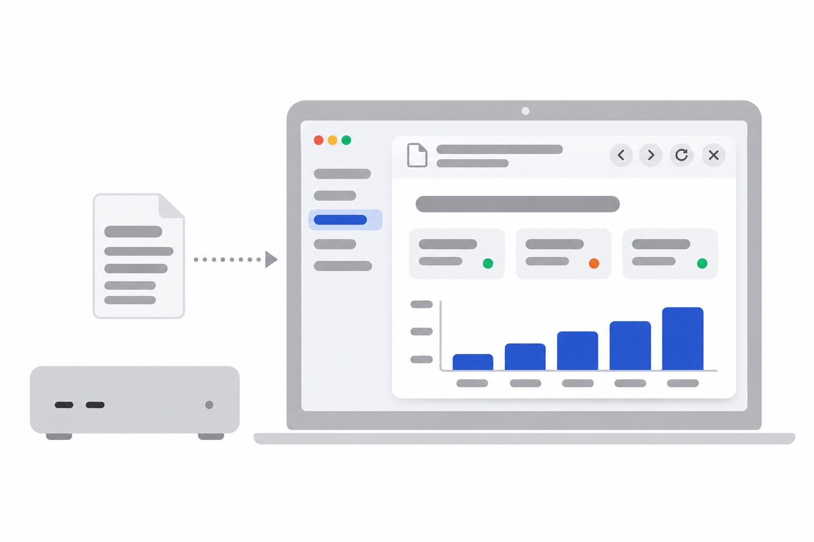
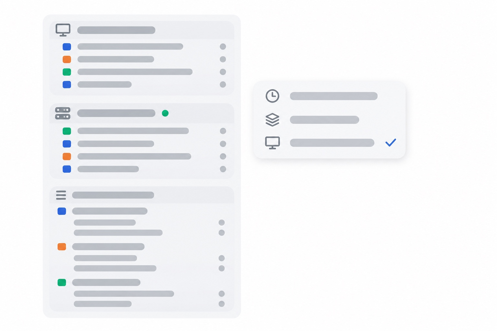

<p align="center">
  
</p>

<h1 align="center">herdr-history-ko</h1>

<p align="center">
  Herdr 에서 에이전트에게 맡긴 일을 요청 단위로 되짚고,<br>
  에이전트가 연 문서를 그 자리에서 보고, 여러 컴퓨터의 에이전트를 한 사이드바에서 나눠 보는 한국어 키트입니다.
</p>

<p align="center">
  <a href="CHANGELOG.md"></a>
  
  
  <a href="LICENSE"></a>
</p>

<p align="center">
  <a href="#빠른-시작">빠른 시작</a> ·
  <a href="#기능">기능</a> ·
  <a href="#필요한-것">필요한 것</a> ·
  <a href="#설정">설정</a> ·
  <a href="#동작-방식과-개인-정보">동작 방식과 개인 정보</a> ·
  <a href="#문제-해결">문제 해결</a>
</p>

> 이 문서의 그림은 기능을 설명하는 일러스트입니다. 실제 화면의 글자와 세부 모양은 다릅니다.

## 빠른 시작

```sh
git clone https://github.com/bytrustu/herdr-history-ko.git
cd herdr-history-ko
sh install.sh
```

설치가 끝나면 Herdr 의 레이아웃이 `history-sidebar` 로 바뀝니다. 원래 쓰던 레이아웃으로는 Herdr 에서 `ctrl-shift-l` 로 돌아갑니다.
Herdr 안의 에이전트에게 「이 폴더의 install.sh 로 설치해 줘」라고 맡겨도 됩니다.

## 기능

### 히스토리 패널



지금 보고 있는 에이전트에게 보낸 요청을 하나씩 나눠 보여 줍니다. Claude Code · Codex · Antigravity 대화를 읽고, Herdr 에 추가한 다른 컴퓨터의 에이전트도 그 컴퓨터에서 읽어 옵니다.

| 보이는 곳 | 내용 |
| --- | --- |
| 요청 줄 | 제목, 상태(진행 중 · 확인 기다림 · 끝남 · 중단함 · 멈춤), 보낸 시각, 걸린 시간, 명령 수, 바꾼 파일 수, 문서 수 |
| 누가 했나 | 그 에이전트의 모델과 effort, 함께 일한 서브에이전트 · Codex · Antigravity · Claude |
| 요청 창 | 요약 · 답변 · 진행 과정 · 바꾼 파일 · 보낸 글 탭, 실행 · 수정 · 읽기 비중을 보여 주는 작업 흐름 |
| 맨 위 | 이 대화의 주제와 지금까지 한 일 한 문장, 요청 수, 컨텍스트 크기 |

요청 제목과 요약은 내 컴퓨터의 Claude Code 로 만들고, 보낸 글 원문은 요청 창의 「보낸 글」 탭에만 둡니다.
패널에서 `↑` `↓` 로 고르고 `Enter` 로 열며, 요청 창에서는 `←` `→` 로 앞뒤 요청을 보고 `Esc` 로 닫습니다.

### 문서 보기



에이전트가 「열어 보세요」 한 HTML 문서를 Herdr 안에서 바로 봅니다. 원격 Mac 같은 다른 컴퓨터의 에이전트가 연 문서도 이 컴퓨터로 가져와 보여 주므로, 그쪽 화면을 따로 열지 않아도 됩니다.

- **문서로 잡는 것**: 에이전트가 `open` 으로 연 파일, 에이전트가 만들거나 고친 HTML, 답변에 적은 경로(지금 있는 파일만). HTML · SVG · PNG · JPG · GIF · WebP.
- **여는 곳**: 히스토리 머리의 「문서 N」, 요청 창의 「문서」 단추, 명령 `request-log.docs`.
- **빠르게 보기**: 한 번 본 문서는 바로 뜨고, 그사이 바뀌었으면 새로 그립니다. 다음 문서는 미리 그려 둡니다.
- **브라우저로 열기**: 링크를 누르거나 입력해야 하는 문서는 이 컴퓨터의 브라우저로 엽니다.

### 한글 사이드바



Herdr 의 스페이스 · 에이전트 목록을 한글로 바꾸고, 여러 컴퓨터를 쓸 때 어느 컴퓨터의 것인지 한눈에 보이게 정리했습니다.

- 「이 컴퓨터」와 Herdr 에 추가한 다른 컴퓨터 아래에 스페이스가 들여 쓰여 나옵니다. 컴퓨터 줄을 누르면 접힙니다.
- 에이전트 정렬은 세 가지입니다. **급한 순서**(확인 필요 · 끝남 · 작업 중 · 쉬는 중), **스페이스별**, **컴퓨터별**.
- 화면 공유가 켜진 다른 Mac 줄에는 화면 공유를 여는 단추가 생깁니다.

### 레이아웃

| 레이아웃 | 구성 |
| --- | --- |
| `history-sidebar` (기본) | 한글 사이드바 + 히스토리 패널 + 문서 보기 |
| `history` | Herdr 기본 사이드바 + 히스토리 패널 + 문서 보기 |

## 필요한 것

| 항목 | 쓰는 곳 | 없을 때 |
| --- | --- | --- |
| macOS 의 Herdr 앱 | 전체 (0.1.16 에서 확인) | 설치가 멈춥니다 |
| Python 3.9 이상 | 대화 읽기, 문서 가져오기 | 설치가 멈춥니다 |
| Xcode 명령줄 도구 | 문서 보기에서 문서를 그림으로 그리기 | 문서 창에 설치 방법이 나옵니다 (`xcode-select --install`) |
| Claude Code 로그인 | 요청 제목과 요약 | 패널은 열리고, 제목 자리에 에이전트가 한 말의 첫 문장이 나옵니다 |

## 설치 · 업데이트 · 지우기

| 하는 일 | 명령 |
| --- | --- |
| 설치 | `sh install.sh` |
| 기본 사이드바로 설치 | `sh install.sh --layout history` |
| 업데이트 | `git pull && sh install.sh` |
| 설치한 버전 보기 | `sh install.sh --status` |
| 같은 이름의 모드가 이미 있을 때 바꾸기 | `sh install.sh --force` |
| 지우기 | `sh install.sh --remove` |

- 설치할 때마다 바꾸기 전의 파일을 임시 폴더에 복사해 두고 그 위치를 알려 줍니다.
- 지우기는 이 키트가 설치한 모드와 레이아웃만 지웁니다. 지금 화면이 이 키트의 레이아웃이면 먼저 Herdr 기본 레이아웃으로 돌려놓습니다.
- 바뀐 내용은 [CHANGELOG.md](CHANGELOG.md) 에 버전마다 적습니다.

## 설정

레이아웃 파일(`~/.config/herdr-app/layouts/history-sidebar.json`)의 `"id": "requests"` 블록에 `props` 를 줍니다.

```json
{ "mod": "request-log", "props": { "summaries": true, "model": "sonnet", "browser": "Safari" } }
```

| 값 | 뜻 | 기본 |
| --- | --- | --- |
| `summaries` | `false` 면 Claude 로 제목 · 요약을 만들지 않습니다 | `true` |
| `model` | 제목 · 요약에 쓸 Claude 모델 | `sonnet` |
| `browser` | 문서 보기의 「브라우저로 열기」가 쓸 앱 이름 | 기본 브라우저 |

## 동작 방식과 개인 정보

| 항목 | 내용 |
| --- | --- |
| 읽는 파일 | 내 컴퓨터에 남은 Claude Code · Codex · Antigravity 대화 기록. 처음에는 끝 32MB 만, 그다음에는 늘어난 부분만 읽습니다 |
| 적어 두는 곳 | `~/.cache/herdr-request-log` (정리한 기록), `~/.cache/herdr-doc-view` (가져온 문서) |
| Claude 로 보내는 것 | 요청 글과 답변의 앞부분. 내 컴퓨터의 `claude` 명령을 구독 로그인으로 부르고, API 키는 쓰지 않습니다 |
| 실행하는 명령 | 어느 대화인지 찾느라 `ps` · `lsof`, 다른 컴퓨터를 읽느라 `hc`, 화면 공유 단추를 보일지 정하느라 `ssh -G` · `nc` |
| 문서 보기 | 문서와 같은 폴더의 그림 · CSS · 글꼴을 가져와 macOS 의 WebKit 으로 그립니다. 문서가 웹 글꼴 같은 인터넷 주소를 부르면 브라우저로 열 때처럼 그 주소에 접속합니다 |

## 문제 해결

<details>
<summary>문서 창에 「Xcode 명령줄 도구가 필요합니다」가 나와요</summary>

터미널에서 `xcode-select --install` 로 설치한 뒤 문서 창의 「다시 해 보기」를 누릅니다.
</details>

<details>
<summary>요청 제목 대신 에이전트가 한 말의 첫 문장이 나와요</summary>

이 컴퓨터에 Claude Code 로그인이 없거나 사용 한도에 걸린 경우입니다. 패널 맨 위에 까닭이 나오고, 로그인하거나 한도가 풀리면 다시 만듭니다.
</details>

<details>
<summary>「어느 대화인지 가려내지 못했습니다」가 나와요</summary>

같은 폴더에서 Codex 를 여럿 띄우는 등 대화가 여럿 겹친 경우입니다. 잘못된 대화를 보여 주지 않으려고 고르지 않습니다.
</details>

<details>
<summary>설치가 「이 키트가 설치하지 않은 같은 이름이 이미 있습니다」에서 멈춰요</summary>

예전에 따로 받은 히스토리 패키지가 있는 경우입니다. `sh install.sh --force` 로 바꾸면 됩니다. 바꾸기 전의 파일은 임시 폴더에 복사해 둡니다.
</details>

<details>
<summary>Herdr 를 업데이트했는데 사이드바가 그대로예요</summary>

한글 사이드바는 Herdr 0.1.16 의 기본 사이드바를 복제해 고친 것이라 Herdr 업데이트가 들어오지 않습니다. 맞춰야 할 변경이 생기면 이 키트의 새 버전으로 냅니다. 기본 사이드바를 쓰려면 `history` 레이아웃으로 바꿉니다.
</details>

## 만드는 사람에게

내 Herdr 에서 고친 것을 이 저장소로 옮길 때는 다음 순서로 합니다.

1. `sh tools/export.sh` 로 `~/.config/herdr-app` 의 모드를 저장소로 옮기고, 개인 경로가 섞였는지 검사합니다.
2. `VERSION` 을 올리고 `CHANGELOG.md` 에 바뀐 것을 적습니다.
3. 커밋한 뒤 `git tag v<버전>` 으로 표시하고 올립니다.

다른 에이전트가 빈 폴더에서 같은 것을 만들 수 있도록 [RECIPE.md](RECIPE.md) 에 화면 · 동작 · 구성을 적어 두었습니다.

## 바탕과 라이선스

히스토리 패널은 [herunan/herdr-over9k](https://github.com/herunan/herdr-over9k) 의 Timeline(MIT)을 바탕으로 했습니다(`mods/request-log/LICENSE.over9k`).
이 저장소는 [MIT 라이선스](LICENSE)입니다. 문서의 그림은 Codex 의 이미지 생성으로 만들었습니다.
