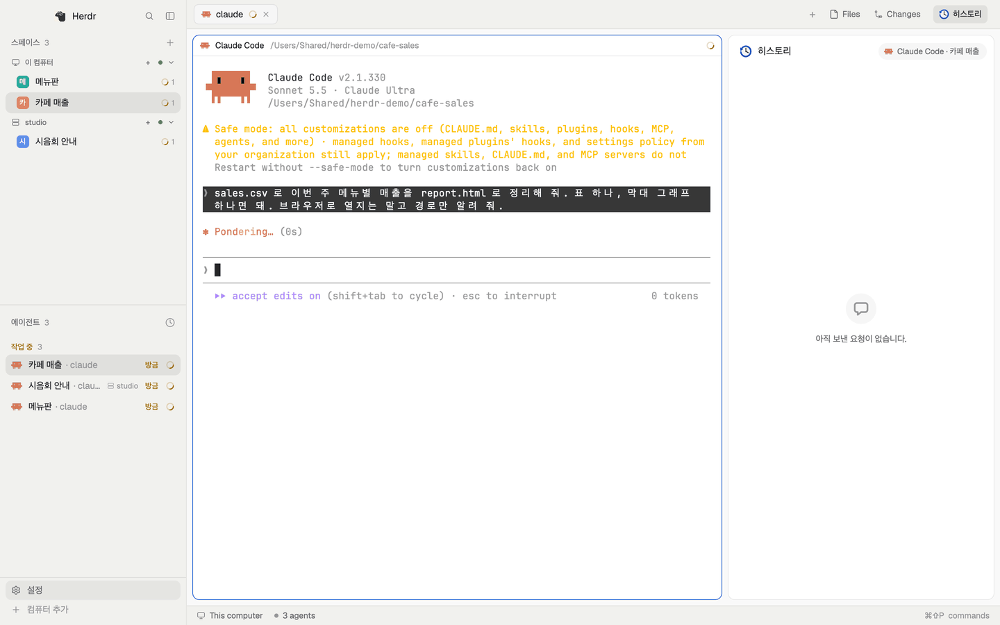
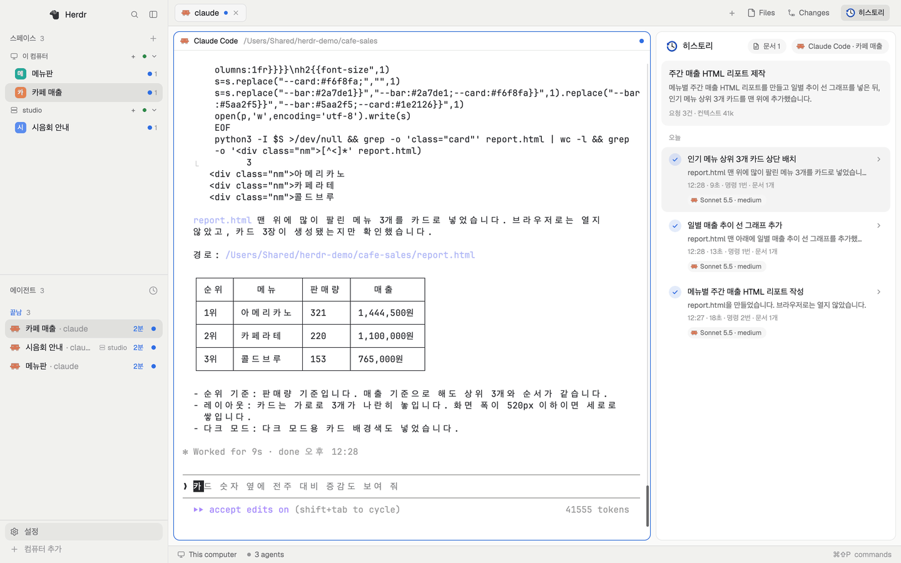
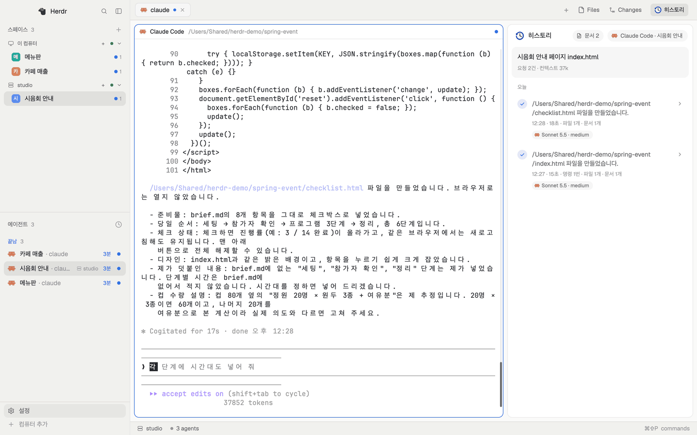
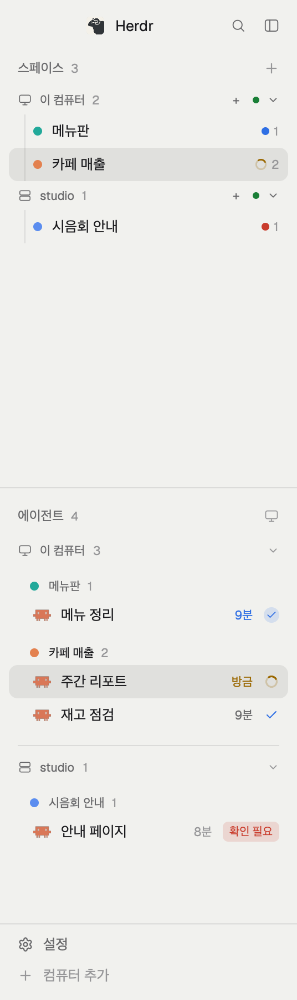
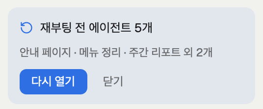

<h1 align="center">Session History KR</h1>

<p align="center">
  터미널에서 코딩 에이전트를 돌리는 macOS 앱 Herdr에 히스토리 패널, 문서 보기, 한글 사이드바를 더하는 키트입니다.<br>
  에이전트에게 맡긴 일을 요청별로 확인하고, 에이전트가 연 문서를 앱 안에서 바로 볼 수 있습니다.
</p>

<p align="center">
  <a href="CHANGELOG.md"></a>
  
  
  <a href="LICENSE"></a>
</p>

<p align="center">
  <a href="#빠른-시작">빠른 시작</a> ·
  <a href="#기능">기능</a> ·
  <a href="#필요한-것">필요한 것</a> ·
  <a href="#설정">설정</a> ·
  <a href="#동작-방식과-개인-정보">동작 방식과 개인 정보</a> ·
  <a href="#문제-해결">문제 해결</a>
</p>

## 빠른 시작

```sh
git clone https://github.com/bytrustu/herdr-history-ko.git
cd herdr-history-ko
sh install.sh
```

설치가 끝나면 Herdr의 레이아웃이 `history-sidebar`로 바뀝니다. Herdr에서 `ctrl-shift-l`을 누르면 원래 쓰던 레이아웃으로 돌아갑니다.

직접 명령을 입력하지 않고 Herdr의 에이전트에게 「이 폴더의 install.sh 로 설치해 줘」라고 맡겨도 됩니다.

## 기능

아래 그림은 공개용 데모 폴더(`/Users/Shared/herdr-demo`)에서 찍은 실제 화면입니다. 「studio」는 녹화를 위해 같은 Mac에 따로 띄운 `hc`를 Herdr에 다른 컴퓨터로 추가한 것입니다. 문서와 기록을 가져오는 방식은 실제 원격 컴퓨터와 같습니다.

### 히스토리 패널



「카페 매출」 스페이스에서 Claude Code에 매출 보고서를 요청하고 상태 변화를 살펴보는 모습 (2.5배속)

패널에는 지금 보고 있는 에이전트에게 보낸 요청이 한 줄씩 쌓입니다. Claude Code, Codex, Antigravity 대화를 읽고, Herdr에 추가한 다른 컴퓨터의 기록은 그 컴퓨터에서 가져옵니다.

요청을 보내면 「진행 중」 항목이 추가되고, 명령 실행 승인을 기다릴 때는 「확인 기다림」으로 바뀝니다. 작업이 끝나면 「끝남」 상태가 되면서 이 컴퓨터의 Claude Code가 만든 제목과 한 줄 요약이 붙습니다.

각 줄에는 제목과 상태 외에 보낸 시각, 걸린 시간, 명령 수, 바꾼 파일 수, 문서 수, 사용한 모델과 effort가 함께 표시됩니다. 상태에는 「중단함」과 「멈춤」도 있습니다. 패널 맨 위에서는 대화 주제와 지금까지 한 일을 정리한 한 문장, 요청 수와 컨텍스트 크기를 확인합니다.

### 요청 창



목록에서 요청 하나를 열어 앞뒤 요청을 넘겨 봅니다.

「누가 했나」에는 모델과 effort, 출력 토큰이 나옵니다. 서브에이전트나 Codex, Antigravity, Claude와 함께 일했다면 그 이름도 여기에 나옵니다. 작업 흐름 그래프는 실행, 수정, 읽기의 비중을 보여 줍니다.

세부 내용은 「요약」, 「답변」, 「진행 과정」, 「바꾼 파일」, 「보낸 글」 탭으로 나뉩니다. 「요약」 탭에는 결론, 한 일, 확인한 것, 남은 것이 정리되고, 보낸 글 원문은 「보낸 글」 탭에서만 봅니다.

패널에서는 `↑` `↓`로 요청을 고른 뒤 `Enter`로 열고, 요청 창에서는 `←` `→`로 앞뒤 요청을 오가며 `Esc`로 닫습니다.

### 문서 보기



다른 컴퓨터 「studio」의 에이전트가 만든 `checklist.html`과 `index.html`을 히스토리 위쪽 「문서 2」 단추로 여는 과정

에이전트가 연 문서를 Herdr 안에서 바로 봅니다. 원격 Mac 같은 다른 컴퓨터의 문서도 이 컴퓨터로 가져와 보여 주며, HTML, SVG, PNG, JPG, GIF, WebP 형식을 열 수 있습니다. 에이전트가 `open`으로 연 파일과 만들거나 고친 HTML, 답변에 적힌 경로 중 실제 파일이 있는 항목이 문서 목록에 들어갑니다.

문서 창은 히스토리 위쪽의 「문서 N」이나 요청 창의 「문서」 단추, `request-log.docs` 명령으로 엽니다. 창 위쪽에는 컴퓨터 이름, 문서 경로, 「브라우저로 열기」 단추가 놓여 있습니다.

미리 그려 두었거나 한 번 본 문서는 바로 뜨고, 파일이 바뀌면 다시 그립니다. 링크를 누르거나 내용을 입력해야 할 때는 「브라우저로 열기」로 이 컴퓨터의 브라우저에서 띄울 수 있습니다.

### 한글 사이드바



「이 컴퓨터」 아래에 메뉴판과 카페 매출, 「studio」 아래에 시음회 안내가 묶인 사이드바

Herdr의 스페이스와 에이전트 목록을 한글로 보여 줍니다. 스페이스는 색 점으로 표시하고, 컴퓨터 아이콘 아래로 내려오는 세로선 안쪽에 들여 써 어느 컴퓨터의 스페이스인지 구분합니다. 컴퓨터 줄을 누르면 그 아래 목록이 접힙니다. 화면 공유를 켠 다른 Mac 줄에는 화면 공유를 여는 단추가 붙습니다.

에이전트는 「급한 순서」, 「스페이스별」, 「컴퓨터별」로 정렬할 수 있습니다. 「급한 순서」에서는 「확인 필요」, 「끝남」, 「작업 중」, 「쉬는 중」 순으로 나열됩니다. 작업 중인 에이전트는 이름이 굵고 줄 바탕이 옅게 칠해집니다. 작업이 끝났지만 아직 확인하지 않은 에이전트는 옅은 동그라미 안에 체크가 표시되고, 확인하면 체크만 남습니다. 확인한 에이전트는 끝난 뒤 한 시간 동안 체크와 줄이 또렷하게 보입니다. 한 시간이 지나면 체크가 회색으로 바뀌고 줄 전체가 흐려집니다. Antigravity는 터미널 제목을 남기지 않아 agy가 저장한 대화 제목을 대신 보여 줍니다.

<br clear="all">

### 재부팅 뒤 에이전트 다시 열기



Mac을 재부팅하거나 Herdr 코어가 다시 시작되면 Herdr는 각 터미널의 원래 주소와 폴더로 셸만 다시 띄웁니다. 한글 사이드바는 1분마다 터미널에 열려 있는 대화 ID를 기록합니다. 다시 열 수 있는 대화가 있으면 에이전트 목록 위에 「재부팅 전 에이전트 N개」 카드가 나타납니다. 「다시 열기」를 누르면 새 셸만 남은 터미널에서 이전 대화를 이어서 엽니다.

대화를 다시 열 때는 그 터미널의 셸에 Claude Code는 `claude --resume <ID>`, Codex는 `codex resume <ID>`, Antigravity는 `agy --conversation <ID>`를 입력합니다. 셸에 설정한 별칭과 함수가 그대로 적용되고, 처음 실행할 때 지정한 모델이나 권한 모드 같은 옵션도 명령에 함께 붙습니다. Herdr에 추가한 다른 컴퓨터의 에이전트도 같은 방식으로 엽니다.

진행 중이던 요청은 다시 실행하지 않습니다. 직접 종료한 에이전트와 메시지를 보내지 않아 대화 기록이 없는 세션은 목록에서 빠집니다. 「닫기」를 누르면 이번 안내만 닫힙니다. `sidebar-agents.revive` 명령에 단축키를 지정해 대화를 다시 열 수도 있습니다.

<br clear="all">

### 레이아웃

| 레이아웃 | 구성 |
| --- | --- |
| `history-sidebar` (기본) | 한글 사이드바 + 히스토리 패널 + 문서 보기 |
| `history` | Herdr 기본 사이드바 + 히스토리 패널 + 문서 보기 |

## 필요한 것

| 항목 | 쓰는 곳 | 없을 때 |
| --- | --- | --- |
| macOS의 Herdr 앱 | 전체 기능(0.1.16에서 확인) | 설치가 멈춥니다 |
| Python 3.9 이상 | 대화 읽기, 문서 가져오기 | 설치가 멈춥니다 |
| Xcode 명령줄 도구 | 문서 보기에서 문서 그리기 | 문서 창에 설치 방법이 나옵니다(`xcode-select --install`) |
| Claude Code 로그인 | 요청 제목과 요약 | 패널은 열립니다. 제목 자리에는 에이전트가 한 말의 첫 문장이 나옵니다. |

## 설치 · 업데이트 · 지우기

| 하는 일 | 명령 |
| --- | --- |
| 설치 | `sh install.sh` |
| 기본 사이드바로 설치 | `sh install.sh --layout history` |
| 업데이트 | `git pull && sh install.sh` |
| 설치한 버전 보기 | `sh install.sh --status` |
| 같은 이름의 모드가 이미 있을 때 바꾸기 | `sh install.sh --force` |
| 지우기 | `sh install.sh --remove` |

설치할 때마다 기존 파일을 임시 폴더에 복사하며, 복사한 위치는 설치 과정에서 알려 줍니다.

`sh install.sh --remove`는 이 키트가 설치한 모드와 레이아웃만 지웁니다. 키트의 레이아웃을 쓰고 있다면 먼저 Herdr 기본 레이아웃으로 되돌립니다.

버전별 변경 사항은 [CHANGELOG.md](CHANGELOG.md)에 있습니다.

## 설정

레이아웃 파일(`~/.config/herdr-app/layouts/history-sidebar.json`)에서 `"id": "requests"` 블록에 `props`를 넣습니다.

```json
{ "mod": "request-log", "props": { "summaries": true, "model": "sonnet", "browser": "Safari" } }
```

| 설정 | 설명 | 기본값 |
| --- | --- | --- |
| `summaries` | `false`로 두면 Claude로 제목과 요약을 만들지 않습니다. | `true` |
| `model` | 제목과 요약을 만드는 데 쓸 Claude 모델 | `sonnet` |
| `browser` | 문서 보기에서 「브라우저로 열기」를 눌렀을 때 쓸 앱 이름 | 기본 브라우저 |

## 동작 방식과 개인 정보

이 컴퓨터에 저장된 Claude Code, Codex, Antigravity 대화 기록을 읽되, 처음에는 파일 끝에서 32MB까지만 읽고 그 뒤부터는 새로 쌓인 부분만 이어서 읽습니다. 정리한 기록은 `~/.cache/herdr-request-log`에, 가져온 문서는 `~/.cache/herdr-doc-view`에 저장합니다.

제목과 요약을 만들 때는 요청 글과 답변의 앞부분을 Claude에 보냅니다. 별도의 API 키는 쓰지 않고, 이 컴퓨터의 `claude` 명령을 실행해 Claude Code 구독 로그인으로 인증합니다.

에이전트가 어느 대화를 열었는지는 `ps`와 `lsof`로 찾고, 다른 컴퓨터의 기록을 읽을 때는 `hc`를 씁니다. 화면 공유 단추를 표시할지는 `ssh -G`와 `nc`로 확인합니다.

에이전트를 다시 열 수 있도록 터미널별 대화 ID, 폴더, 실행 옵션을 `~/.local/state/herdr-revive`에 기록합니다. 대화 내용은 저장하지 않습니다. 「다시 열기」를 누르면 `hc send`로 그 터미널의 셸에 명령을 입력합니다.

문서 보기는 문서와 같은 폴더에 있는 그림, CSS, 글꼴도 함께 가져와 macOS의 WebKit으로 그립니다. 문서 안에 웹 글꼴처럼 인터넷 주소로 된 리소스가 있으면 브라우저에서 열 때와 마찬가지로 그 주소에 접속합니다.

## 문제 해결

<details>
<summary>문서 창에 「Xcode 명령줄 도구가 필요합니다」가 나옵니다</summary>

터미널에서 `xcode-select --install`을 실행한 뒤, 설치가 끝나면 문서 창의 「다시 해 보기」를 누릅니다.
</details>

<details>
<summary>요청 제목 대신 에이전트가 한 말의 첫 문장이 나옵니다</summary>

이 컴퓨터에서 Claude Code에 로그인하지 않았거나 사용 한도에 걸린 경우입니다. 이유는 패널 맨 위에 표시되며, 로그인하거나 한도가 풀리면 제목을 다시 만듭니다.
</details>

<details>
<summary>「어느 대화인지 가려내지 못했습니다」가 나옵니다</summary>

같은 폴더에서 Codex를 여러 개 띄우면 대화가 겹칠 수 있습니다. 어느 대화인지 확실하지 않을 때는 패널에 표시하지 않습니다.
</details>

<details>
<summary>설치 중 「이 키트가 설치하지 않은 같은 이름이 이미 있습니다」가 나옵니다</summary>

예전에 따로 받은 히스토리 패키지가 남아 있으면 설치가 멈춥니다. `sh install.sh --force`로 덮어쓸 수 있으며, 기존 파일은 임시 폴더에 복사해 둡니다.
</details>

<details>
<summary>Herdr를 업데이트했는데 사이드바가 그대로입니다</summary>

한글 사이드바는 Herdr 0.1.16의 기본 사이드바를 복사해 고친 모드여서 Herdr 업데이트가 반영되지 않습니다. 반영할 변경이 생기면 이 키트의 새 버전으로 냅니다. Herdr 기본 사이드바를 쓰려면 `history` 레이아웃으로 바꾸면 됩니다.
</details>

<details>
<summary>재부팅했는데 「다시 열기」 안내가 나오지 않습니다</summary>

1분마다 기록하므로 재부팅 직전에 연 에이전트는 저장되지 않았을 수 있습니다. 메시지를 보내지 않아 대화 기록이 없는 세션도 이어서 열 대화가 없어 빠집니다. 다른 컴퓨터의 에이전트는 그 컴퓨터가 연결되어 있을 때만 표시됩니다. 이 기능은 한글 사이드바에 들어 있어 `history` 레이아웃에서는 나오지 않습니다.
</details>

## 만드는 사람에게

로컬 Herdr에서 고친 모드는 다음 순서로 저장소에 옮깁니다.

1. `sh tools/export.sh`를 실행합니다. 이 명령은 `~/.config/herdr-app`의 모드를 저장소로 옮기고 개인 경로가 섞였는지 검사합니다.
2. `VERSION`을 올리고, 바뀐 내용을 `CHANGELOG.md`에 적습니다.
3. 커밋한 뒤 `git tag v<버전>`으로 태그를 붙여 올립니다.

다른 에이전트가 빈 폴더에서 같은 키트를 만들 수 있도록 화면, 동작, 구성을 [RECIPE.md](RECIPE.md)에 적어 두었습니다.

## 바탕과 라이선스

히스토리 패널은 [herunan/herdr-over9k](https://github.com/herunan/herdr-over9k)의 Timeline(MIT)을 바탕으로 만들었습니다. 원본 라이선스는 `mods/request-log/LICENSE.over9k`에 있습니다.

이 저장소는 [MIT 라이선스](LICENSE)를 따릅니다.
