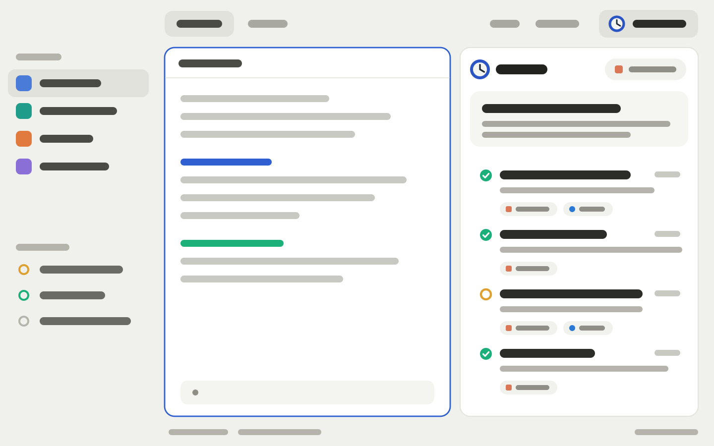

# herdr-history-ko

Herdr 오른쪽에 「히스토리」 패널을 붙이고 왼쪽 사이드바를 한글로 다듬은 레이아웃이다. 패널은 지금 보고 있는 에이전트(Claude Code · Codex · Antigravity)에게 보낸 요청을 하나씩 나눠, 요청마다 무엇을 했고 누가(모델 · effort) 했는지 보여 준다. 사이드바는 컴퓨터 아래에 스페이스를 들여 쓰고, 에이전트를 급한 순서 · 스페이스별 · 컴퓨터별로 정렬한다. 화면 글자는 모두 한국어다.

레이아웃은 둘이다. `history-sidebar` 는 한글 사이드바와 히스토리, `history` 는 Herdr 기본 사이드바와 히스토리다.

**What you see:**

왼쪽에서 오른쪽으로.

- **사이드바**(268px, `chrome` 바탕): 위 46px 는 기본 `workspace-chrome`, 가운데는 스페이스 목록과 에이전트 목록이 같은 비율(각각 최소 90px), 바닥 69px 는 「설정」 · 「컴퓨터 추가」.
  - 스페이스 목록: 머리 「스페이스 N」과 +. 다른 컴퓨터가 등록되어 있으면 컴퓨터 줄(11px, 이 컴퓨터는 모니터 아이콘과 「이 컴퓨터」, 다른 컴퓨터는 서버 아이콘과 이름, 연결 점, +, 접기 화살표)이 생기고 그 아래 스페이스 줄이 8px 들여 쓰인다. 스페이스 줄은 색 표지(이름 첫 글자), 이름, 평범하지 않을 때만 저장소 · 브랜치, 오른쪽에 그 안의 에이전트 수와 가장 급한 상태.
  - 화면 공유(5900)가 열린 다른 컴퓨터 줄에는 화면 공유 단추가 붙는다.
  - 에이전트 목록: 머리 「에이전트 N」과 정렬 아이콘(급한 순서 시계 · 스페이스별 겹친 층 · 컴퓨터별 모니터).
    - 스페이스별: 스페이스 머리(15px 색 표지, 이름, 수) 아래 에이전트 줄(앱 아이콘, 제목, 지난 시간, 상태). 다른 컴퓨터의 스페이스는 머리 끝에 서버 아이콘과 컴퓨터 이름.
    - 컴퓨터별: 컴퓨터 머리(13px 아이콘, 이름, 수, 접기 화살표) 아래 스페이스 묶음이 8px 들여 쓰인다. 두 번째 컴퓨터부터 위에 1px 선.
    - 급한 순서: 확인 필요 · 끝남 · 작업 중 · 쉬는 중 구역. 줄은 「스페이스 · 제목」, 다른 컴퓨터 줄 끝에 서버 아이콘과 이름.
- **탭 줄**(42px): 기본 `tabs` 와 오른쪽 96px 「히스토리」 단추(15px 시계 아이콘 `icon.png` + 글자). 패널이 열려 있으면 단추가 눌린 면으로 보인다.
- **본문**(안쪽 여백 8, 간격 8): 터미널, 숨은 파일 · 변경 패널, 히스토리 칸(384px, 300~720px 로 끌어 바꿈). 맨 아래 상태 줄 28px.
- **히스토리 패널**: 테두리 대신 바탕보다 옅은 면(`raised`)으로 나눈다.
  - 머리: 18px 아이콘과 「히스토리」(14px 굵게), 오른쪽에 따라가는 에이전트 칩(앱 아이콘 + 「앱 이름 · 스페이스」).
  - 주제 카드: 대화 전체의 주제, 지금까지 한 일 한 문장, 「요청 N건 · 컨텍스트 Nk」.
  - 날짜 묶음(「오늘」 · 「어제」 · 「11월 17일 월요일」) 아래 최근 요청부터 한 줄씩: 상태 표지, 제목, 지금 하는 일이나 답변 첫 문장, 「시각 · 걸린 시간 · 명령 N번 · 파일 N개 · 덧붙인 말 N개」, 모델 알약(앱 아이콘 + 「모델 · effort」)과 함께 일한 쪽 알약(셋까지, 넘으면 「+N」).
- **요청 창**(줄을 누르면 뜨는 모달): 제목과 시각, 「누가 했나」(한 줄에 한 쪽: 아이콘, 이름, 어떻게 맡았는지, 모델, effort 눈금 다섯 칸, 출력 토큰과 몫 막대), 「작업 흐름」(같은 폭 칸의 기둥과 실행 `#2a78d6` · 수정 `#eb6834` · 읽기 · 검색 `#1baf7a` · 그 밖 구성 막대), 탭 다섯(요약 · 답변 · 진행 과정 · 바꾼 파일 · 보낸 글).

**How it behaves:**

- 패널은 지금 들어가 있는 에이전트를 따라가고, 없으면 마지막에 본 것을 둔다. 일하는 동안 2초, 쉬는 동안 6초마다 읽고, 패널이 숨어 있으면 읽지 않는다.
- 요청의 상태 표지(동그라미 안 아이콘, 테마 색): 가장 최근 요청이 끝나지 않았고 에이전트가 working 이면 「진행 중 N분」(도는 고리, `working`), blocked 이면 「확인 기다리는 중」(물음표, `blocked`). 끝난 요청은 체크(`done`)와 걸린 시간, 사용자가 끊은 요청은 「중단함」(정지, `muted`), 끝나지 않은 채 에이전트가 idle 이거나 더 새 요청이 온 것은 「멈춤」(일시정지, `muted`). 진행 중인 줄은 옅게 물든 면이다.
- 제목: 패널이 보이는 동안 제목이 없는 요청을 12개씩 Claude 에게 받아 적어 둔다. 받기 전에는 에이전트가 한 말의 첫 문장이 제목 자리에 온다. 요약은 400자 넘는 답변을 창으로 열 때 한 번 받는다. 실패하면 사용 한도 30분 · 로그인 없음 10분 · 명령 없음 30분 쉬고, 그 까닭을 맨 위에 적는다.
- 보낸 글 원문은 창의 「보낸 글」 탭에서만 보인다.
- 키: 패널에서 ↑/↓ 로 가리키고 Enter 로 연다. 창에서 ←/→ 로 앞뒤 요청, Esc 로 닫는다. 진행 중인 요청을 열어 두면 끝까지 따라간다. 명령 `request-log.latest` · `.next` · `.prev` · `.toggle` · `.close`, 창이 열려 있을 때 `.digest` · `.reply` · `.steps` · `.files` · `.sent` · `.older` · `.newer`.
- 에이전트 목록: 정렬 아이콘을 누르면 「정렬」 팝업(셋 가운데 고른 것에 체크). 묶음 머리를 누르면 접히고, 접힌 머리에는 수와 가장 급한 상태가 남는다. 줄에 마우스를 올리면 고정 핀, 상태 표지에 마우스를 올리면 「확인 필요」 같은 말.
- 스페이스 목록: 누르면 바뀌고, 오른쪽 클릭은 메뉴, 끌면 순서가 바뀐다(원본 그대로). 컴퓨터 줄을 누르면 그 컴퓨터의 스페이스가 접힌다. 화면 공유 단추는 `vnc://사용자@주소` 를 연다.

**Built from:**

- `layouts/history-sidebar.json`: Herdr 0.1.16 의 `main` 레이아웃에서 바꾼 것. 사이드바 블록의 `content.mod` 를 `sidebar-spaces` · `sidebar-agents` · `sidebar-chrome`(props `{"footer": true}`)으로. `work` 의 탭 블록을 `tabs-row`(row, 42px, `resizable: false`: `tabs` weight 1 + `requests-toggle` 96px `{mod: "request-log", props: {role: "toggle"}}`)로 감싸고, `work-body` 의 `panel` 뒤에 `requests-panel`(column, 384px, min 300, max 720) 안의 블록 `requests` `{mod: "request-log"}` 를 넣었다. `layouts/history.json` 은 사이드바만 기본(`spaces` · `agents` · `workspace-chrome`)이다.
- `mods/request-log`: `main.js` 한 파일에 역할 셋(패널 · `role: "toggle"` 단추 · `role: "detail"` 창, `openOverlay`). props `summaries: false`(제목 · 요약 끔), `model`(요약 모델), `panel`(단추가 여닫을 칸 id). 쓰는 `herdr` 함수: `agents` · `focused` · `layout` · `run("layout.toggle")` · `openOverlay` · `closeOverlay` · `nextCommand` · `exec` · `appHome` · `theme` · `settings`. 그림: `icon.png`, `icons/*.svg`(선 아이콘), 앱의 `icons/claude.svg` · `codex.svg` · `antigravity.svg`.
- `mods/request-log/reader.py`(표준 라이브러리만, Python 3.9+): 패널이 `python3 -I reader.py <터미널> [알던 경로] [알던 크기] [다시 찾기]` 로 부른다.
  - 어느 대화인지: 환경의 `HC_TERMINAL_ID` 가 그 터미널인 프로세스(`ps -wwE`). Claude Code 는 `~/.claude*/sessions/<pid>.json` → `projects/<폴더>/<세션>.jsonl`. Codex 는 그 프로세스가 연 `rollout-*.jsonl`(`lsof`), 백그라운드 서버에 붙은 경우는 서버가 연 대화 가운데 일하는 폴더가 같은 것. Antigravity 는 그 `agy` 가 연 `~/.gemini/antigravity-cli/presence/<id>.lock` → `conversations/<id>.db`.
  - 다른 컴퓨터: `reader.py --on <컴퓨터> …` 가 자기 파일을 `hc file write --on` 으로 올리고 `hc exec --json --on` 으로 거기서 읽는다.
  - 제목 · 요약: `claude -p --model sonnet` 을 API 키 없이(환경을 비우고) 구독 로그인으로 부른다. 받은 것은 `~/.cache/herdr-request-log/` 에 둔다.
- `mods/sidebar-spaces` · `sidebar-agents` · `sidebar-chrome`: 기본 `spaces` · `agents` · `workspace-chrome`(0.1.16)을 `mod.clone` 으로 복제해 글자를 한글로 바꾸고 위계를 더한 것. `sidebar-spaces` 는 `hc machine ls --json` 으로 컴퓨터를, `exec("ssh", ["-G", …])` 와 `nc -z -G 2 <주소> 5900` 으로 화면 공유를 5분마다 알아보고 `open` 으로 연다. `sidebar-agents` 는 `shared("agents.sort")` 에 `priority` · `grouped` · `machines` 를 둔다. 아이콘은 기본 `mods/workspace-chrome/*.svg`.

**Watch out:**

- 대화를 못 찾으면 짐작하지 않고 비워 둔다. 같은 폴더의 Codex 가 여럿이거나 agy 잠금 파일이 여럿이면 고르지 않고 알린다.
- 대화 파일은 수백 MB 가 되기도 한다. 처음에는 끝 32MB 만, 그다음은 늘어난 부분만 읽는다.
- Antigravity 대화는 SQLite(WAL) 안의 protobuf 다. 스키마가 공개되어 있지 않아 번호는 기록을 읽어 맞췄다(`reader.py` 의 「Antigravity(agy) 의 대화」 주석). agy 는 쓸 때만 열고 닫아 평소에는 `-wal` 이 없다: 그때는 `immutable` 로 읽고, `-wal` 이 있으면 사본을 만들어 읽는다. 같은 크기로 고쳐 쓰이므로 바뀌었는지는 고친 시각으로 본다.
- `claude -p --output-format json` 은 2.1.328 에서 결과 하나가 아니라 이벤트 배열을 낸다.
- 사이드바 복제본은 Herdr 업데이트를 받지 않는다. 미리 보려고 `herdr-app do mod.open` 을 쓰지 않는다(지금 레이아웃에 블록이 더해진다).
- `herdr-app check` 는 기본 역할만 그린다. 단추 · 창 · 접힌 사이드바는 값을 넣은 임시 사본으로 확인한다.

**Done when:**

- 네 모드가 `herdr-app check` 를 통과하고 `herdr-app status` 의 `errors` 가 비어 있다.
- `layout.switch {"name": "history-sidebar"}` 뒤 탭 줄 오른쪽에 「히스토리」 단추가 있고, 누르면 384px 패널이 열리고 닫힌다.
- Claude Code · Codex · agy 가 도는 터미널에 들어가면 그 대화의 요청이 최근 것부터 나오고, 줄을 누르면 창이 열린다.
- Herdr 에 추가한 다른 컴퓨터의 에이전트에 들어가도 요청이 나온다.
- 에이전트 정렬 팝업에 세 가지가 있고, 컴퓨터별에서 「이 컴퓨터」와 다른 컴퓨터 머리가 나뉜다.
- `claude` 로그인이 없으면 제목 자리에 에이전트가 한 말의 첫 문장이 오고, 맨 위에 까닭이 나온다.
